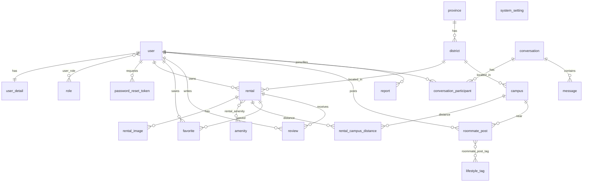

# Kế hoạch Database — HoLaHome

Dựa trên entity hiện có (`user`, `role`, `user_role`, `user_detail`) và các module template:
`rentals`, `owner`, `roommates`, `reviews`, `messages`, `account/favorites`, `admin/reports`, `admin/settings`, `auth`.

## 1. Quy ước chung

| Hạng mục | Quy ước |
|---|---|
| Engine / Charset | InnoDB, `utf8mb4` / `utf8mb4_0900_ai_ci` (MySQL 8) |
| Tên | `snake_case`, số ít (`rental`, `review`) — khớp `user`, `role` hiện có |
| PK | `BIGINT AUTO_INCREMENT` (khớp `Long id` trong JPA) |
| Tiền | `DECIMAL(12,0)` lưu **VND** (vd. `3800000`), không dùng float |
| Toạ độ | `DECIMAL(9,6)` cho `latitude` / `longitude` |
| Enum | `VARCHAR(20)` + `@Enumerated(EnumType.STRING)` |
| Audit | `created_at`, `updated_at` `DATETIME NOT NULL` |
| Xoá mềm | `status` (HIDDEN/DELETED) thay vì xoá cứng với bài đăng, review |

> [!WARNING]
> `user` là từ khoá dành riêng trong MySQL. Hiện vẫn chạy được, nhưng nên cân nhắc đổi thành `app_user` trước khi có dữ liệu thật (xem câu hỏi mở).

## 2. Sơ đồ quan hệ (ERD)

## 3. Chi tiết bảng theo module

### Module A — Tài khoản & Phân quyền (đã có, bổ sung)

**`user`** — giữ nguyên. Thêm index: không cần (đã unique `username`, `email`).

**`role`** — giữ nguyên. Seed: `ROLE_ADMIN`, `ROLE_EMPLOYEE`, `ROLE_OWNER`, `ROLE_USER`.

**`user_role`** — PK kép `(user_id, role_id)`, FK `ON DELETE CASCADE`.

**`user_detail`** — bổ sung cột cho trang `edit-profile`:

| Cột | Kiểu | Ghi chú |
|---|---|---|
| `occupation` | VARCHAR(50) | `STUDENT`, `WORKER`... |
| `campus_id` | BIGINT NULL | FK → `campus` (trường đang học, dùng gợi ý radar) |
| `avatar_url` | VARCHAR(500) NULL | |
| `bio` | VARCHAR(500) NULL | dùng cho ghép trọ |

**`password_reset_token`** — cho `/forgot-password`

| Cột | Kiểu | Ghi chú |
|---|---|---|
| `id` | BIGINT PK | |
| `user_id` | BIGINT NOT NULL | FK → user, CASCADE |
| `token_hash` | CHAR(64) NOT NULL UNIQUE | SHA-256, không lưu token thô |
| `expires_at` | DATETIME NOT NULL | |
| `used_at` | DATETIME NULL | |

**`persistent_logins`** — chỉ cần nếu dùng `JdbcTokenRepositoryImpl` cho "Ghi nhớ đăng nhập" (schema chuẩn của Spring Security).

### Module B — Địa lý & Trường học

**`province`** (`id`, `code` UNIQUE, `name`) · **`district`** (`id`, `province_id` FK, `code` UNIQUE, `name`)

**`campus`** — tâm Radar & bộ lọc "Bước 1"

| Cột | Kiểu | Ghi chú |
|---|---|---|
| `id` | BIGINT PK | |
| `code` | VARCHAR(30) UNIQUE | `BACHKHOA`, `FPT`, `VINH`... |
| `name` | VARCHAR(150) | |
| `short_name` | VARCHAR(50) | "ĐH Bách Khoa HN" |
| `district_id` | BIGINT FK | |
| `latitude`, `longitude` | DECIMAL(9,6) | cổng chính |

### Module C — Phòng trọ (lõi)

**`rental`**

| Cột | Kiểu | Ghi chú |
|---|---|---|
| `id` | BIGINT PK | |
| `owner_id` | BIGINT NOT NULL | FK → user, RESTRICT |
| `title` | VARCHAR(150) NOT NULL | |
| `slug` | VARCHAR(180) UNIQUE | URL thân thiện |
| `description` | TEXT | |
| `building_name` | VARCHAR(100) NULL | "Nhà trọ" hiển thị trên badge |
| `room_type` | VARCHAR(20) | `ROOM`, `STUDIO`, `MINI_APARTMENT`, `DUPLEX` |
| `price` | DECIMAL(12,0) NOT NULL | VND/tháng |
| `deposit` | DECIMAL(12,0) NULL | |
| `area` | DECIMAL(5,1) NOT NULL | m² |
| `max_occupants` | TINYINT UNSIGNED | |
| `electricity_price` | DECIMAL(10,0) | VND/kWh |
| `water_price` | DECIMAL(10,0) | |
| `water_unit` | VARCHAR(20) | `PER_PERSON`, `PER_M3`, `FIXED` |
| `address` | VARCHAR(255) NOT NULL | |
| `district_id` | BIGINT NOT NULL | FK |
| `latitude`, `longitude` | DECIMAL(9,6) | |
| `tour_360_url` | VARCHAR(500) NULL | nút "Xem 360" |
| `status` | VARCHAR(20) NOT NULL | `DRAFT`, `PENDING`, `ACTIVE`, `RENTED`, `HIDDEN`, `REJECTED` |
| `verified` | BOOLEAN DEFAULT FALSE | "đã kiểm duyệt thực tế" |
| `available_from` | DATE NULL | |
| `view_count` | INT UNSIGNED DEFAULT 0 | |
| `created_at`, `updated_at` | DATETIME | |

Index: `idx_rental_status_price (status, price)`, `idx_rental_district_status (district_id, status)`, `idx_rental_owner (owner_id)`, `idx_rental_area (area)`.

**`rental_image`** (`id`, `rental_id` FK CASCADE, `url`, `sort_order` SMALLINT, `is_cover` BOOLEAN). Index `(rental_id, sort_order)`.

**`amenity`** (`id`, `code` UNIQUE, `name`, `icon`) — seed: `no_curfew`, `loft`, `balcony`, `pet`, `full_furniture`, `fingerprint`, `private_wc`, `air_con`, `parking`...

**`rental_amenity`** — PK `(rental_id, amenity_id)`, CASCADE phía rental.

**`rental_campus_distance`** — tính sẵn để lọc "Bán kính tới trường" nhanh

| Cột | Kiểu | Ghi chú |
|---|---|---|
| `rental_id`, `campus_id` | BIGINT | PK kép, CASCADE |
| `distance_km` | DECIMAL(5,2) | |
| `walk_min`, `bike_min` | SMALLINT UNSIGNED | |

Index: `idx_rcd_campus_distance (campus_id, distance_km)`. Tính lại khi rental đổi toạ độ.

### Module D — Tương tác người dùng

**`favorite`** — PK `(user_id, rental_id)`, `created_at`. CASCADE cả 2 phía.

**`review`**

| Cột | Kiểu | Ghi chú |
|---|---|---|
| `id` | BIGINT PK | |
| `rental_id` | BIGINT NOT NULL | FK CASCADE |
| `user_id` | BIGINT NOT NULL | FK CASCADE |
| `rating` | TINYINT UNSIGNED | `CHECK (rating BETWEEN 1 AND 5)` |
| `comment` | TEXT | |
| `status` | VARCHAR(20) | `VISIBLE`, `HIDDEN` |

`UNIQUE uq_review_user_rental (user_id, rental_id)`, index `(rental_id, status)`.

### Module E — Ghép trọ

**`roommate_post`**

| Cột | Kiểu | Ghi chú |
|---|---|---|
| `id` | BIGINT PK | |
| `user_id` | BIGINT NOT NULL | FK CASCADE |
| `rental_id` | BIGINT NULL | FK SET NULL — nếu đã có phòng |
| `title` | VARCHAR(150) | |
| `description` | TEXT | sticky note |
| `district_id` | BIGINT NULL | FK |
| `campus_id` | BIGINT NULL | FK |
| `budget` | DECIMAL(12,0) | VND/người |
| `gender_target` | VARCHAR(10) | `MALE`, `FEMALE`, `ANY` |
| `slots` | TINYINT UNSIGNED | số người cần tìm |
| `move_in_date` | DATE NULL | |
| `status` | VARCHAR(20) | `OPEN`, `CLOSED`, `HIDDEN` |

**`lifestyle_tag`** (`id`, `code` UNIQUE, `name`) + **`roommate_post_tag`** PK `(post_id, tag_id)` — thói quen: không hút thuốc, ngủ sớm, nuôi mèo...

### Module F — Nhắn tin

**`conversation`** (`id`, `rental_id` NULL FK SET NULL, `roommate_post_id` NULL FK SET NULL, `last_message_at` DATETIME, `created_at`)

**`conversation_participant`** — PK `(conversation_id, user_id)`, `last_read_at` DATETIME NULL (đếm tin chưa đọc).

**`message`** (`id`, `conversation_id` FK CASCADE, `sender_id` FK, `content` TEXT, `created_at`). Index `(conversation_id, created_at)`.

### Module G — Quản trị

**`report`**

| Cột | Kiểu | Ghi chú |
|---|---|---|
| `id` | BIGINT PK | |
| `reporter_id` | BIGINT NOT NULL | FK |
| `target_type` | VARCHAR(20) | `RENTAL`, `ROOMMATE_POST`, `REVIEW`, `USER` |
| `target_id` | BIGINT NOT NULL | đa hình — không FK |
| `reason` | VARCHAR(30) | `SCAM`, `WRONG_INFO`, `SPAM`... |
| `detail` | VARCHAR(1000) | |
| `status` | VARCHAR(20) | `OPEN`, `RESOLVED`, `REJECTED` |
| `handled_by` | BIGINT NULL | FK SET NULL |
| `handled_at` | DATETIME NULL | |

Index `(status, created_at)`, `(target_type, target_id)`.

**`system_setting`** (`setting_key` VARCHAR(100) PK, `setting_value` TEXT, `updated_at`) — cho `admin/settings` (siteName, adminEmail...).

## 4. Quy tắc xoá (tóm tắt)

| Quan hệ | ON DELETE |
|---|---|
| user → rental (owner) | `RESTRICT` (phải chuyển/ẩn bài trước) |
| rental → image / amenity / distance / favorite / review | `CASCADE` |
| user → favorite / review / roommate_post / reset token | `CASCADE` |
| roommate_post.rental_id, conversation.*_id, report.handled_by | `SET NULL` |
| message.sender_id | `RESTRICT` (giữ lịch sử chat) |

> [!NOTE]
> Thực tế hầu như không xoá cứng `user`; dùng `enabled = false`. Các rule CASCADE chủ yếu phục vụ dọn dữ liệu test.

## 5. Lộ trình triển khai

| Phase | Nội dung | Mở khoá màn hình |
|---|---|---|
| 1 | Flyway + baseline 4 bảng hiện có, `password_reset_token` | register, forgot-password |
| 2 | `province`, `district`, `campus`, `amenity` + seed | bộ lọc Bước 1–5 |
| 3 | `rental`, `rental_image`, `rental_amenity`, `rental_campus_distance` | index (bento, radar), rentals/*, owner/* |
| 4 | `favorite`, `review` | account/favorites, reviews/* |
| 5 | `roommate_post`, `lifestyle_tag`, `roommate_post_tag` | roommates/*, corkboard trang chủ |
| 6 | `conversation`, `conversation_participant`, `message` | messages/* |
| 7 | `report`, `system_setting` | admin/reports, admin/settings |

Mỗi phase: migration Flyway `V{n}__*.sql` → JPA entity + repository → service → thay mock data (`ROOMS_DATA` trong `index.js`) bằng dữ liệu thật.

## 6. Câu hỏi mở

1. **Migration tool**: dự án chưa có Flyway/Liquibase và `ddl-auto` đang tắt. Đề xuất thêm **Flyway** — đồng ý không?
2. **Bảng `user`**: giữ nguyên hay đổi thành `app_user` ngay bây giờ (khi chưa có dữ liệu thật)?
3. **Đơn vị tiền**: lưu VND nguyên (`3800000`) như đề xuất, hay lưu "triệu" dạng `DECIMAL(5,2)` giống mock hiện tại?
4. **Phạm vi địa lý**: chỉ Hà Nội + Vinh (seed tĩnh), hay cần toàn quốc (tỉnh/quận/phường)?
5. **Khoảng cách**: tính sẵn bằng công thức Haversine (đề xuất), hay dùng Google/OSM API để có thời gian di chuyển thực?
6. **Ảnh**: lưu file local (`/uploads`) hay dịch vụ ngoài (S3/Cloudinary)? Chỉ ảnh hưởng ý nghĩa cột `url`.
